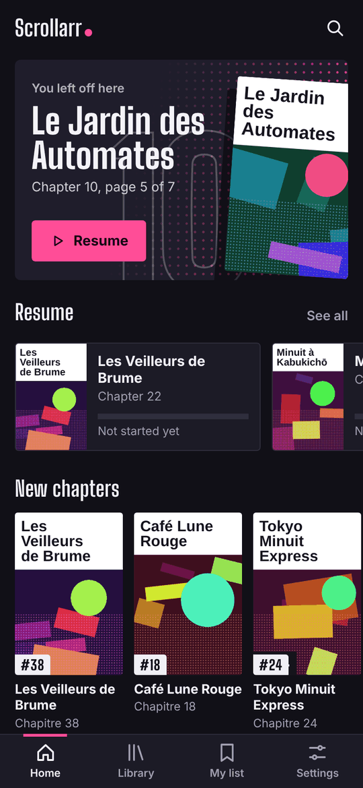
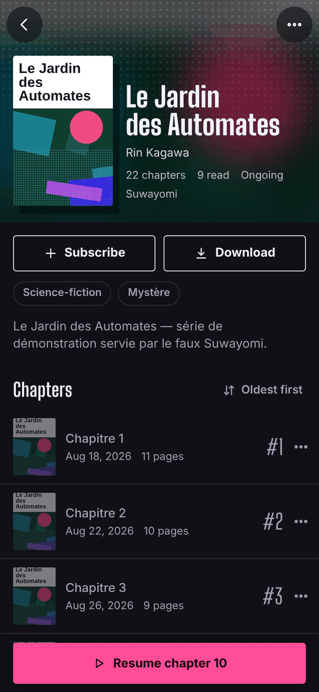
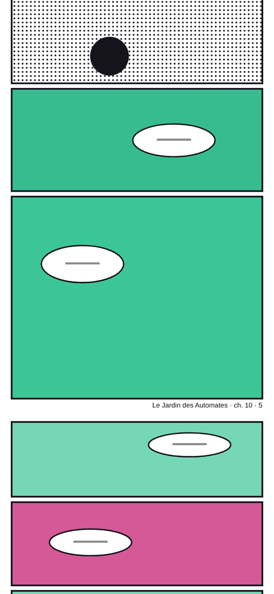
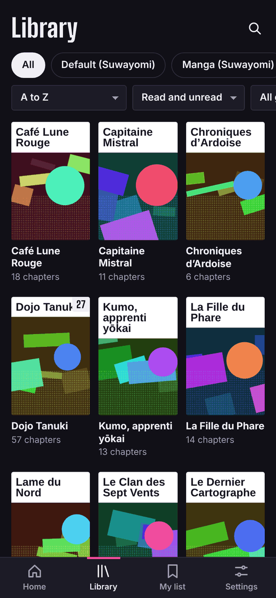
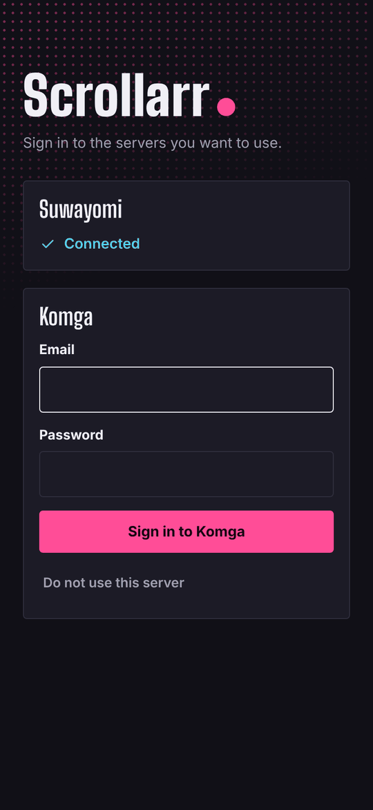
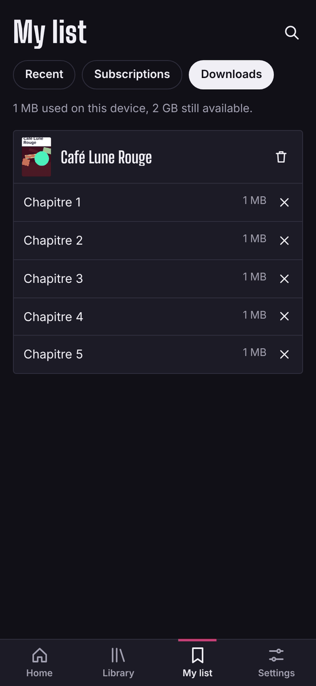
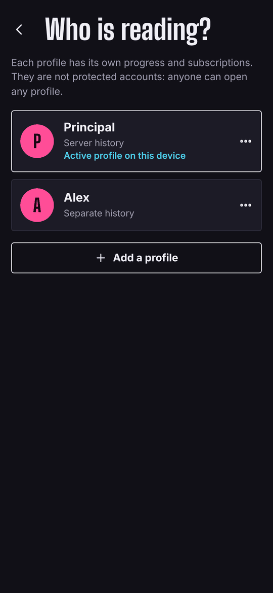

# Scrollarr

[English](README.md) · **Français**

Scrollarr est un lecteur vertical continu pour la bibliothèque de mangas de votre propre serveur : vous faites défiler un chapitre d'un seul geste, vous passez au suivant, et vous reprenez exactement où vous vous étiez arrêté. C'est une application web installable (PWA), sans compte tiers ni télémétrie. Elle lit depuis [Suwayomi](https://github.com/Suwayomi/Suwayomi-Server), depuis [Komga](https://komga.org), depuis les deux à la fois, ou depuis de simples dossiers de scans grâce à un service facultatif. Licence MIT.

Projet indépendant, sans lien avec Suwayomi, Komga ni aucun service de lecture commercial.

| Accueil | Série | Lecteur | Fin de chapitre |
| --- | --- | --- | --- |
|  |  |  |  |

| Bibliothèque fusionnée | Connexion aux serveurs | Téléchargements hors ligne | Profils |
| --- | --- | --- | --- |
|  |  |  |  |

*Captures réalisées avec la bibliothèque de démonstration fournie dans `dev/`.*

## Ce que fait Scrollarr

- **Lecture verticale.** Pages empilées sans espace (ou avec un, à votre choix), chargées à l'approche et libérées derrière vous. Barres qui s'estompent pendant le défilement, curseur de page, défilement automatique, écran maintenu allumé. Une carte « chapitre suivant » à la fin, avec les pages suivantes préchargées.
- **Reprise et progression.** La page atteinte est enregistrée sur le serveur, donc ses autres applications la voient. Hors ligne, la progression attend et part plus tard.
- **Hors ligne.** Enregistrez des chapitres sur l'appareil et lisez-les sans connexion (HTTPS nécessaire).
- **Profils.** Plusieurs personnes partagent une installation avec une progression et des abonnements séparés. Ce ne sont pas des comptes : pas de mot de passe.
- **Plusieurs serveurs.** Suwayomi, Komga et Dossiers peuvent servir ensemble ; les listes sont fusionnées et les doublons de titre ne sont montrés qu'une fois.
- **Bibliothèque et abonnements.** Filtrez par catégorie, genre et état de lecture, cherchez, suivez une série : un badge « UP » signale les nouveaux chapitres, et la liste vous suit d'un appareil à l'autre. Notifications push facultatives.
- **Dossiers.** Lisez de simples dossiers d'images et des archives CBZ/ZIP sans Suwayomi ni Komga.
- **Collecte depuis les sources de Suwayomi.** Depuis l'écran de recherche, cherchez un titre chez les sources de votre Suwayomi et ajoutez-le à sa bibliothèque. Rien n'est envoyé à une source tant que vous ne le demandez pas.
- **Suivi des téléchargements.** Demandez à Suwayomi de télécharger des chapitres, puis suivez-les, annulez-les ou relancez-les depuis *Réglages > Téléchargements*.
- Thèmes clair et sombre, interface en français et en anglais.

## Comment tout s'assemble

```
navigateur ──► Scrollarr (nginx, port 8380)
                ├── /           l'application (fichiers statiques)
                ├── /suwayomi/  relais vers votre Suwayomi
                ├── /komga/     relais vers votre Komga
                ├── /folders/   relais vers le service Dossiers (facultatif)
                └── /notify/    relais vers le notifier push (facultatif)
```

Le navigateur ne parle qu'à Scrollarr. Scrollarr place chaque serveur sous sa propre adresse, ainsi la session d'un serveur charge aussi ses images. L'application est du JavaScript pur, sans étape de construction. Elle n'ajoute aucune connexion à elle : quiconque atteint Scrollarr obtient ce que vos serveurs donnent à quelqu'un qui n'est pas connecté. Lisez [Sécurité](docs/fr/security.md) avant de l'exposer.

## Démarrage rapide

Il vous faut Docker avec Compose, un Suwayomi ou un Komga en marche, et (pour l'application complète) une adresse HTTPS, voir [Installation](docs/fr/installation.md). Deux fichiers suffisent, les images sont téléchargées :

```sh
mkdir scrollarr && cd scrollarr
curl -O https://raw.githubusercontent.com/Ark4ntes/scrollarr/main/deploy/docker-compose.yml
curl -o .env https://raw.githubusercontent.com/Ark4ntes/scrollarr/main/.env.example
# modifiez .env : SUWAYOMI_URL=http://192.168.1.10:4567 (ou KOMGA_URL=...), l'autre vide
docker compose up -d
```

Ouvrez `http://192.168.1.10:8380` (l'adresse de votre machine, port 8380). Vous devez voir un écran de connexion ou l'accueil. Pour construire les images vous-même depuis un clone : [Installation](docs/fr/installation.md#installer-depuis-un-clone).

Étapes suivantes :

- Placez-la derrière HTTPS (proxy inversé et certificat) : sans cela, les téléchargements hors ligne, l'installation sur l'écran d'accueil et les notifications sont indisponibles. Sur un NAS Synology : [NAS Synology](docs/fr/synology.md).
- Sur téléphone : sur iPhone ou iPad, ouvrez l'adresse dans Safari et utilisez *Partager*, puis *Sur l'écran d'accueil* ; sur Android, Chrome propose d'installer l'application depuis son menu.
- Un problème ? [Dépannage](docs/fr/troubleshooting.md).

### Rester à jour

```sh
git pull && docker compose up -d --build           # installé depuis un clone
docker compose pull && docker compose up -d        # installé depuis les images publiées
```

Rechargez ensuite l'application deux fois sur chaque appareil. Sauvegardez d'abord `.env` et `data/` : [Mise à jour, sauvegarde, retour en arrière](docs/fr/update-backup.md).

## Serveurs pris en charge

Ce que déclare chaque connecteur (détails et limites dans [Connecteurs](docs/fr/connectors.md)) :

| | Suwayomi | Komga | Dossiers (service facultatif) |
| --- | --- | --- | --- |
| Lire séries, chapitres, pages ; chercher | Oui | Oui | Dossiers d'images, `.cbz`, `.zip` |
| Progression de lecture | Historique propre du serveur | Historique propre du serveur | Tenue par le service |
| Profils et abonnements entre appareils | Oui | Oui | Non |
| Demander au serveur de télécharger des chapitres ; suivre les tâches | Oui | Non | Non |
| Chercher chez les sources par titre et ajouter une série | Oui | Non | Non |
| Connexion | Aucune, basic, simple login ou UI login | Compte Komga | Mot de passe partagé, ou aucun |
| Notifications push (facultatif) | Oui | Oui, avec une clé d'API | Non |

D'autres serveurs (Kavita...) sont prévus, pas disponibles.

## Guides

| Guide | Contenu |
| --- | --- |
| [Installation](docs/fr/installation.md) | Prérequis et HTTPS, installation depuis un clone ou les images publiées, services facultatifs, premier lancement |
| [Configuration](docs/fr/configuration.md) | Chaque variable, ports, volumes, profils, ce qui est stocké où |
| [NAS Synology](docs/fr/synology.md) | DSM 7 de bout en bout, proxy inversé, accès local seul, pièges rencontrés sur un DS920+ |
| [Mise à jour, sauvegarde, retour en arrière](docs/fr/update-backup.md) | Mettre à jour, figer une version, revenir en arrière, quoi sauvegarder, restaurer |
| [Sécurité](docs/fr/security.md) | Qui atteint quoi, authentification, en-têtes, ce que stocke le navigateur |
| [Dépannage](docs/fr/troubleshooting.md) | Symptôme, cause, solution ; journaux ; quelle version tourne |
| [Connecteurs](docs/fr/connectors.md) | Ce que fournit chaque serveur ; écrire un lecteur ou un collecteur |
| [Développement](docs/fr/development.md) | Serveurs de démonstration, tests, CI, organisation du projet |

Voir aussi : [SECURITY.md](SECURITY.md) (signaler une faille), [CONTRIBUTING.md](CONTRIBUTING.md), [docs/ROADMAP.md](docs/ROADMAP.md).

## Versions de serveurs prises en charge

Dernière revue : 13/11/2026. Une revue hebdomadaire compare chaque nouvelle version des serveurs aux appels que fait Scrollarr (voir `docs/COMPAT-WATCH.md`). « Revue » signifie que les notes de version et les sources du serveur ont été confrontées aux appels de Scrollarr ; « utilisée » signifie que l'auteur la fait tourner.

| Serveur | Revue, aucune régression trouvée | Utilisée par l'auteur | Appels vérifiés |
| --- | --- | --- | --- |
| Suwayomi-Server | de la v2.0.1727 à la v2.4.2366 | 2.3 | opérations GraphQL de `app/js/connectors/suwayomi-queries.js` |
| Komga | jusqu'à la 1.29.2 | oui | points d'accès REST `/api/v1` et `/api/v2/users/me` de `app/js/connectors/readers/komga.js` |

Hors de ce tableau : les versions publiées après la date ci-dessus et les préversions.

## État du projet et limites connues

Première version publiée : 0.9.0 (novembre 2026). Les versions et leurs notes sont dans les [Releases](https://github.com/Ark4ntes/scrollarr/releases) ; les images publiées sont décrites dans [Installation](docs/fr/installation.md#quelles-images-existent).

- **Testé.** Des parcours complets (Suwayomi seul, Komga seul, les deux, les quatre modes d'authentification de Suwayomi, hors ligne, profils, dossiers) passent dans Chrome contre les serveurs factices de `dev/` en CI. nginx a été lancé devant ces serveurs factices. L'auteur l'utilise avec de vrais serveurs Suwayomi et Komga pour la lecture, la progression et les profils.
- **Non essayé.** Safari sur iOS. L'envoi des notifications push (l'abonnement et la détection des nouveaux chapitres fonctionnent en test ; l'envoi lui-même n'a jamais été lancé). La recherche chez les sources et l'ajout d'une série n'ont été testés que contre le serveur factice, pas contre un vrai Suwayomi, et montrent la première page de résultats de chaque source.
- Un chapitre Suwayomi non téléchargé est récupéré chez sa source à l'ouverture : le premier affichage peut prendre plusieurs secondes.
- Il n'y a pas encore de suivi ni de téléchargement automatique des nouveaux chapitres.
- Les doublons entre serveurs ne sont reconnus que par le titre.
- Deux appareils qui modifient la même entrée d'un profil partagé sans s'être vus : l'une des deux est conservée, la même sur chaque appareil, mais rien n'indique laquelle est la plus récente.
- Sur iOS, c'est le système qui décide de l'espace que les téléchargements peuvent occuper, et il peut le récupérer si l'application n'est pas sur l'écran d'accueil.
- Le service Dossiers ne lit que des dossiers d'images et du CBZ/ZIP (ni CBR, RAR, 7z, PDF), et une installation avec Dossiers seul n'a pas de gestion des profils.
- Pas de lecture par pages (de droite à gauche) : Scrollarr est volontairement un lecteur vertical.
- Prévu, pas disponible : des connecteurs pour d'autres serveurs (Kavita...), des applications iOS et Android, un mode double page pour les tablettes. Voir la [feuille de route](docs/ROADMAP.md).

## Licence

MIT, voir [LICENSE](LICENSE). La police Big Shoulders Display est distribuée sous licence SIL OFL 1.1 (`app/fonts/OFL.txt`).
