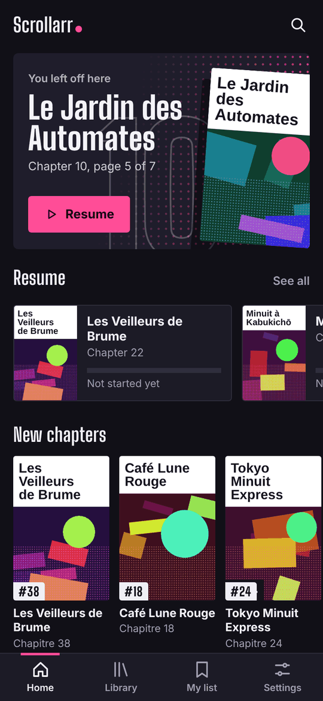
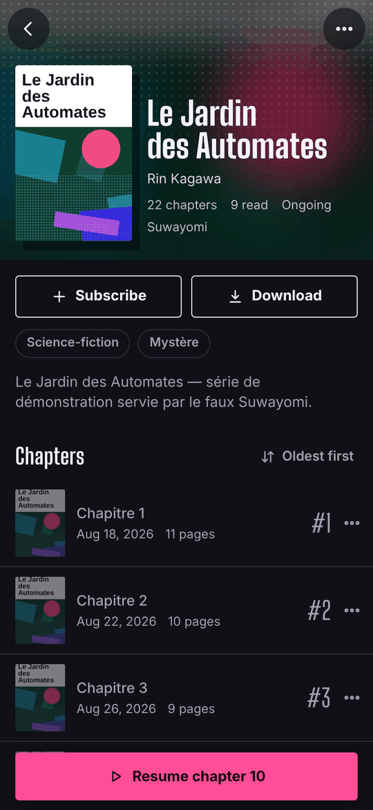
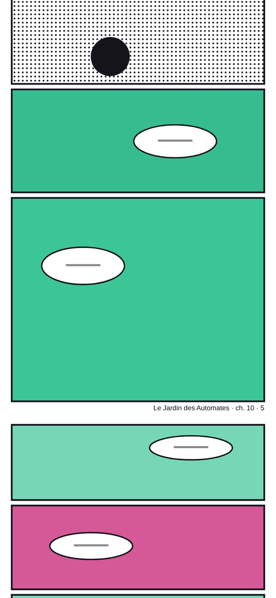
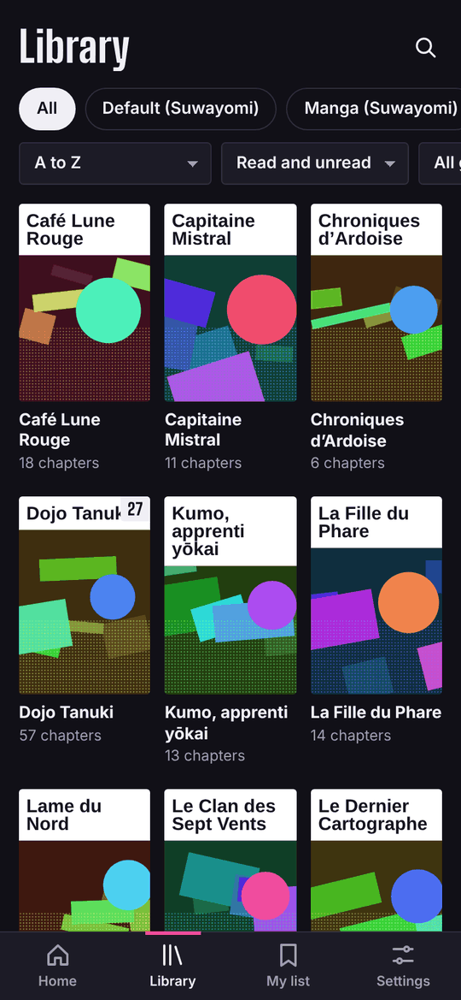
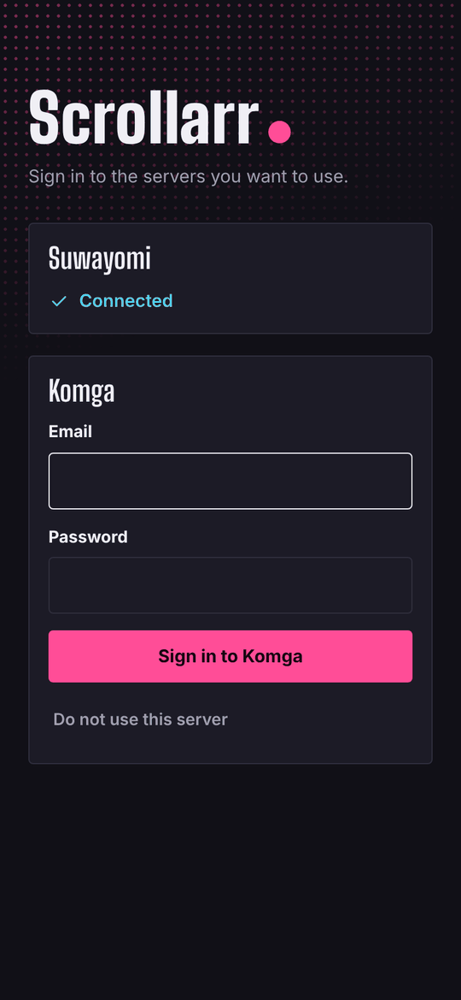
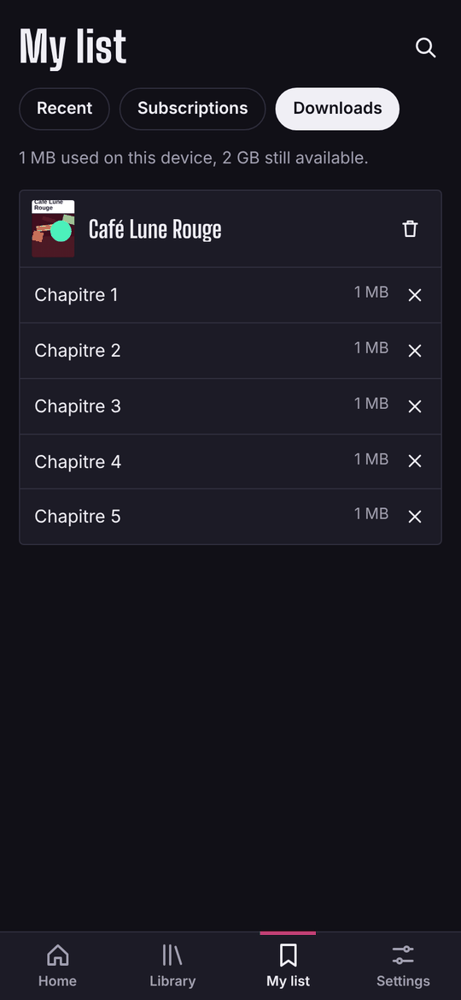
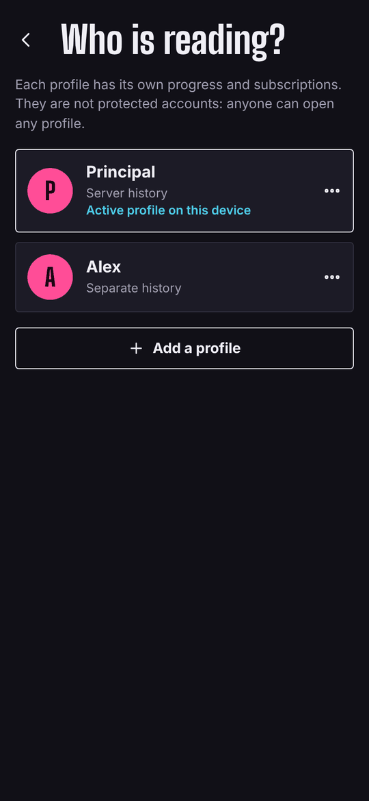

# Scrollarr

**English** · [Français](README.fr.md)

A continuous vertical reader for your self-hosted manga library: scroll through a chapter in one gesture, roll into the next one, and pick up exactly where you stopped. Installable web app (PWA), no third-party account, no telemetry. MIT licensed.

Scrollarr connects to [Suwayomi](https://github.com/Suwayomi/Suwayomi-Server), to [Komga](https://komga.org), or to both at once. With its optional folders service it can also read plain folders of scans (image folders, CBZ/ZIP) with neither of them. Other servers can be added as connectors.

Independent project, not affiliated with Suwayomi, Komga or any commercial reading service.

| Home | Series | Reader | End of chapter |
| --- | --- | --- | --- |
|  |  |  |  |

| Merged library | Servers | Offline | Profiles |
| --- | --- | --- | --- |
|  |  |  |  |

*Screenshots taken with the demo library shipped in `dev/`.*

## What it does

- **Vertical strip reading**: pages stacked with no gap (or with one, your choice), loaded as you approach and released once far behind, so long volumes stay light.
- **Bars that get out of the way** while you scroll and come back on tap; page slider; auto-scroll at an adjustable speed; screen kept awake.
- **Resume and progress**: the current page is saved on the server, so it is shared with its other clients (Suwayomi's web UI, Mihon, Komga's reader…). Offline, progress is queued and sent later.
- **Chaining**: a "next chapter" card at the end, with the first pages of the next chapter preloaded.
- **Home**: one-tap resume, new chapters, new series, recent updates.
- **Library**: filter by library or category, genre and reading status; sort; search.
- **Subscriptions**: follow a series and an "UP" badge flags chapters that arrived since your last visit. The list is copied to your servers so it follows you across devices.
- **Offline**: download chapters to the device and read them without a connection.
- **Push notifications** (optional service) when a chapter arrives in a series you follow.
- Light and dark themes, English and French interface.

### One server, or several

The installation declares which servers are available; each person then picks the ones they use in *Settings > Servers*.

| | Suwayomi | Komga |
| --- | --- | --- |
| What is shown | The manga in your Suwayomi library, by category | Series, by library |
| Chapters | Downloaded on the server, or read live from the source | Files on disk (CBZ, CBR, PDF) |
| Authentication | None, basic auth, simple login or UI login: detected automatically | Komga account |
| Extras | Ask the server to download chapters | On-the-fly conversion of images the browser cannot display |

With two servers active, lists are merged. When a series has the same title on both (typical case: Suwayomi downloads, Komga scans the same folder), only one is shown; the setting *When a series exists on several servers* picks which one, or shows both. Reading progress stays specific to each server.

Scrollarr does not browse Suwayomi's sources or add manga to its library: that is done in Suwayomi's own interface.

### Profiles

Several people can share one installation without sharing their history: *Settings > Profile > Manage profiles*.

- The **main** profile uses the server's own history, so it stays in sync with Suwayomi's or Komga's interface.
- Every **other profile** has its own progress and subscriptions. They are stored on the server (Suwayomi "meta", Komga "client settings") without touching the server's history, and follow the profile across devices.
- When several profiles exist, a new device asks "Who is reading?" once, then remembers.

Profiles are not accounts: there is no password and anyone can open any profile. They do not protect access to the server either (see *Security*). With Komga, separate Komga accounts already give separate, protected histories.

## How it is built

```
browser ──► nginx (scrollarr container)
              ├── /             static files of the app (app/ folder)
              ├── /suwayomi/    proxy to Suwayomi
              ├── /komga/       proxy to Komga
              ├── /servers.json servers configured on this installation
              └── /notify/      proxy to the notifier (optional)
```

The app is plain JavaScript in ES modules with no build step: what is in `app/` is what gets served. The proxy puts every server under the same origin as the app, so its session also works for loading images.

| Folder | Role |
| --- | --- |
| `app/` | The application (HTML, CSS, JS, service worker) |
| `app/js/connectors/` | Connectors, split by role: `readers/` (what you read) and `collectors/` (what fetches chapters) |
| `nginx/` | Web server and proxy configuration |
| `notifier/` | Small Node service that sends push notifications |
| `folders/` | Small Node service that reads scan folders for the "Folders" reader (optional) |
| `dev/` | Mock servers for development, compatibility checker |

## Installation

Requirements: Docker, at least one running server (Suwayomi or Komga), and an **HTTPS** address for Scrollarr. Over plain HTTP the app still reads, but browsers disable installation to the home screen, offline downloads and notifications.

Scrollarr is published as a ready-to-run image, so you do not need to clone the repository. Images (`ghcr.io/ark4ntes/scrollarr` and `ghcr.io/ark4ntes/scrollarr-notifier`, for `amd64` and `arm64`) are published when a version tag is pushed. Until the first release, build from a clone instead (see the alternative below).

1. Create a folder on your machine, for example `/volume1/docker/scrollarr`, and download the two files you need into it:
   ```sh
   curl -O https://raw.githubusercontent.com/Ark4ntes/scrollarr/main/docker-compose.yml
   curl -o .env https://raw.githubusercontent.com/Ark4ntes/scrollarr/main/.env.example
   ```
   Edit `.env`: set `SUWAYOMI_URL` and/or `KOMGA_URL` to the address of each server as seen from the container (for example `http://192.168.1.10:4567`). Leave empty the one you do not use. To read plain folders instead, see *Folders service* below (`FOLDERS_URL`).
2. Start it:
   ```sh
   docker compose up -d
   ```
   The app answers on port `8380` (change it with `SCROLLARR_PORT`). After editing `.env`, recreate the container with `docker compose up -d --force-recreate`.
3. Publish it over HTTPS with your reverse proxy. On a Synology NAS: *Control Panel > Login Portal > Advanced > Reverse Proxy*, source `https://scrollarr.example.com:443`, destination `http://localhost:8380`, then assign the certificate under *Security > Certificate*.
4. Open the address. If a server requires authentication, Scrollarr shows its sign-in form; otherwise you land directly on the home screen.

**Alternative: from a clone.** Copy the repository, then `cp .env.example .env`, fill it in as above and run `docker compose up -d --build`: the images are built locally instead of being pulled.

**Without Compose.** The image alone is enough; both variables are optional and empty by default (an empty address means the server is not configured):

```sh
docker run -d --name scrollarr --restart unless-stopped -p 8380:80 \
  -e SUWAYOMI_URL=http://192.168.1.10:4567 -e KOMGA_URL= \
  ghcr.io/ark4ntes/scrollarr:latest
```

**Healthchecks.** Both images declare one: Scrollarr fetches `/servers.json` every 30 seconds, the notifier calls its `/health` endpoint. `docker ps` (or the Container Manager on Synology) shows `healthy` or `unhealthy` next to each container.

If a server card says it is not responding, the container cannot reach the address in `.env`: `localhost` points to the container itself, and a container name only resolves if both stacks share a Docker network (see the comment at the bottom of `docker-compose.yml`).

### Before deploying: check compatibility with your Suwayomi

From any machine on the network with Node 20 or later:

```sh
node dev/check-suwayomi.mjs http://192.168.1.10:4567
```

The script replays Scrollarr's read queries against your server and reports any it rejects. It changes nothing.

### Security

- A Suwayomi **without authentication** stays without authentication behind Scrollarr, which relays its whole API: anyone who can reach Scrollarr can read and modify the library and the server's settings. Do not expose it to the internet as is; turn on Suwayomi's authentication or keep Scrollarr behind a VPN.
- In basic auth or simple login mode, Suwayomi expects the credentials on every request. Scrollarr keeps them in a browser cookie that the proxy turns into a header, so always serve Scrollarr over HTTPS. UI login mode (renewable token) avoids keeping the password.
- Scrollarr stores no password on the server side.

### On your phone

- **iPhone / iPad**: open the address in Safari, then *Share > Add to Home Screen*. Notifications and durable storage for downloads only exist for the app installed this way.
- **Android**: Chrome offers *Install app* in its menu.

### Komga tip

Keep *Analyze page dimensions* enabled on your libraries (it is by default). Scrollarr then reserves the exact height of each page before it loads, which makes resuming precise. Suwayomi does not provide dimensions: the height is adjusted as each image arrives.

## Push notifications (optional)

1. In `.env`: set `VAPID_SUBJECT` to a contact address. For Komga, create an API key (*My account > API keys*) and put it in `KOMGA_API_KEY`. For a protected Suwayomi, set `SUWAYOMI_USER` and `SUWAYOMI_PASSWORD`.
2. Start with the `push` profile:
   ```sh
   docker compose --profile push up -d
   ```
   (from a clone, before the first release is published, add `--build`).
3. In Scrollarr: *Settings > Notifications*, turn the option on, then *Send a test*.

The notifier polls each server every `POLL_MINUTES` minutes and sends one notification per followed series, even when several chapters arrive together. Its keys and the list of subscribed devices are kept in `data/notifier/`.

## Folders service (optional)

`folders/` is a small Node service that lets Scrollarr read manga stored in plain folders on your server, **without Suwayomi or Komga**. In the app it is a third reader named *Folders*, added last in the priority order (when a series has the same title on another server, the other one wins). It serves libraries, series and chapters, the pages of image folders and CBZ/ZIP archives (streamed, never extracted to disk) and a simple cover per series. Reading rules, limits and how changes in the folders are detected: `folders/README.md`; design and decisions: `docs/design/READ-002-connecteur-dossiers.md`.

**Already have Komga?** Point Komga at the folder instead: it does everything the folders service does and more. The folders service is for people who want Scrollarr alone, or who keep plain folders of images.

It mounts your scans **read-only**, never receives a path from the client (only opaque identifiers), never follows symbolic links, and publishes no port: only the Scrollarr container will reach it, through a dedicated internal Docker network.

```sh
mkdir -p data/folders && sudo chown 1000:1000 data/folders    # data folder, writable by the service
echo 'FOLDERS_SCANS_PATH=/path/to/scans' >> .env              # one folder = one library (see docker-compose.yml)
echo 'FOLDERS_URL=http://folders:8788' >> .env                # lets Scrollarr reach the service (empty = not used)
docker compose --profile folders up -d --build
```

Then open Scrollarr: *Folders* appears among the servers (*Settings > Servers*). The service is only reachable by the Scrollarr container, through the internal network `folders_net`; `FOLDERS_URL` is the only thing the app needs.

**The service refuses to start without an explicit authentication mode.** Set `FOLDERS_AUTH` in `.env`:

| `FOLDERS_AUTH` | Behaviour |
| --- | --- |
| `password` | One shared user and password (`FOLDERS_USER`, `FOLDERS_PASSWORD`, at least 12 characters). Everything except `/health` needs a session (signed `HttpOnly`, `SameSite=Strict` cookie, `Secure` behind HTTPS). Login attempts are limited per address. |
| `none` | No access control at all, a warning is logged at every start. `FOLDERS_USER` and `FOLDERS_PASSWORD` must then be empty. |

Any other value, a missing password, a password shorter than 12 characters, an unknown `FOLDERS_…` variable or a non-numeric limit also stops the service at startup, with a one-line message.

**Security consequences.**
- With `none`, anyone who can reach Scrollarr can list every series and chapter name, read every page and read or change all reading progress. It can never write or delete a file, nor reach a path outside the mounted libraries. Use it only on a trusted local network or behind a VPN. The service cannot check by itself that it is not exposed: behind a proxy, the address it sees is the proxy's.
- The shared password protects access to the service. It does **not** separate people: everyone who knows it sees all scans and can read or change the progress of every profile (profiles are not accounts).
- **Before exposing Scrollarr beyond a trusted local network, use `password` mode, over HTTPS.**
- Requests other than `GET` must carry `X-Requested-With` and `Content-Type: application/json`, and a mismatching `Origin` is refused. This also applies on a local network.

**Layout.** A library is a folder mounted under `/libraries/<name>`; a series is a sub-folder; a chapter is a `.cbz`/`.zip` archive or a folder directly containing images (intermediate folders such as volumes are tolerated, 3 levels at most). Reading order is the natural sort of names (`Chapter 2` before `Chapter 10`). Details, warnings and renaming effects: see the study.

**Pages and covers.** Page and cover images are served as they are (JPEG, PNG, WebP, GIF, AVIF, recognised by their first bytes, never by their extension; anything else, SVG included, is refused). Archives are read in place with [`yauzl`](https://github.com/thejoshwolfe/yauzl), the service's only dependency (version locked in `folders/package-lock.json`); hostile or oversized archives are refused with a readable error (limits in `folders/README.md`).

**What a folders-only install does not have.** Profiles and subscriptions are stored by the *servers* (Suwayomi "meta", Komga "client settings"), and the folders service deliberately stores neither. With *Folders* as the only server:
- no profile management (*Settings* says so, and the *Who is reading?* screen is replaced by an explanation);
- subscriptions stay on the device that made them: they are not shared between devices;
- no genre filter, no "New chapters" and "New series" rows (the home screen shows "Recent updates", ordered by the date of the series folder);
- no "on deck" row (the next chapter of a series in progress is not suggested).

Add Suwayomi or Komga next to it and all of this comes back, stored by that server. Renaming or moving a chapter or a series folder creates a new item (see the study, §4.7).

**Reading progress.** The service stores it itself, so it survives restarts and is shared by every device that opens the same Scrollarr: the page reached, whether the chapter is finished, and the date. The reader resumes where it stopped, *Home* shows "Continue reading" and the recently read chapters, chapters and series can be marked read or unread, and the library can be filtered by reading status. Offline, progress is queued on the device and sent back later, as with the other servers. Progress is kept per profile. The main profile is the shared history of the install; a secondary profile (profiles need a server with a key-value store, so Suwayomi or Komga next to Folders) has its own progress on folders series, stored by the service under the profile's identifier, so it follows the person from one device to another and is not seen by the other profiles. The same profile reading a Suwayomi or Komga series keeps going through its documents on that server, as before. Deleting a profile also deletes its progress on the folders service (retried later if the service is down). Two devices of the same profile writing the same chapter: the last write wins, there is no merge by revision as for Suwayomi and Komga. The service groups writes: at most one write per file every `FOLDERS_PROGRESS_FLUSH_SECONDS` seconds (3 by default, 0 = immediately, 60 at most) and a last one when it stops normally; a hard kill (`SIGKILL`, power loss) can lose the last few seconds only.

**Data.** `data/folders/` holds a session signing key, a small file remembering which libraries have held series, and `progress/` (one small JSON file per series and profile). Back it up by copying it. A progress file that cannot be read is set aside as `<name>.json.corrupt` (never overwritten) and that series starts again from zero; a warning without any path is logged. A library that cannot be read, or that is empty although it used to hold series (share not mounted, encrypted folder locked), is reported `unavailable` in `/health` and answers `503`, never `404`: with a `404` the app would delete your subscriptions.

**Try it without a NAS.**

```sh
node dev/make-folders-fixture.mjs /tmp/folders-demo
FOLDERS_AUTH=none FOLDERS_LIBRARIES_DIR=/tmp/folders-demo/libraries FOLDERS_DATA_DIR=/tmp/folders-demo/data node folders/server.js
curl localhost:8788/api/v1/libraries
```

## Development

The app has no dependencies:

```sh
node dev/mock-servers.mjs
# http://localhost:8380 — Komga: demo@scrollarr.local / demo
```

The demo server imitates Suwayomi and Komga with a generated library.

| Variable | Effect |
| --- | --- |
| `SERVERS=suwayomi` | "Configure" only some servers (`suwayomi`, `komga`, `folders`, comma separated) |
| `SUWA_AUTH=none\|basic\|simple\|ui` | Authentication mode of the mock Suwayomi (credentials `demo` / `demo`) |
| `NOTIFIER=http://127.0.0.1:8787` | Relay `/notify/` to a local notifier |
| `FOLDERS=http://127.0.0.1:8788` | Relay `/folders/` to a real folders service (`SERVERS=folders`); see `tests/e2e_folders.py` |

`POST /suwayomi/__mock/add-chapter?manga=2` and `POST /komga/__mock/add-book?series=S004` simulate a new chapter.

Useful entry points:

- `app/js/api.js`: the facade the screens call; routes to connectors and merges lists.
- `app/js/connectors/readers/`: `komga.js` (REST), `suwayomi.js` (GraphQL). `collectors/suwayomi.js` asks Suwayomi to download chapters. Both Suwayomi modules share `suwayomi-client.js` (session, requests) and `suwayomi-queries.js`.
- `app/js/profiles.js`: profiles and their history.
- `app/js/views/reader.js`: the reader.
- `app/js/i18n.js`: translations (French strings are the keys; add a dictionary for a new language).
- `app/css/app.css`: colours and type are variables at the top of the file.

To run the real container against your working copy (`app/` and the nginx template mounted read-only, so edits show up without rebuilding):

```sh
docker compose -f docker-compose.yml -f docker-compose.dev.yml up -d
```

Code comments are currently in French.

### Writing a connector

A connector is a `create({ base })` function returning an object. `base` is the proxy prefix (`/myserver`). Series and chapters follow the shape of Komga's objects, which serves as the common model; ids are the server's own, the facade takes care of prefixing them.

| Member | Role |
| --- | --- |
| `id`, `code`, `label`, `userLabel` | Identifier, one-letter prefix, display name, label of the username field |
| `capabilities` | What the server can do, from the reader list in `app/js/connectors/contract.js`; the interface only offers what is declared |
| `session()`, `login(user, password)`, `logout()` | Session; `session()` throws `AuthError` when sign-in is required |
| `libraries()`, `genres()` | Library filters |
| `seriesList({ libraryId, genre, readStatus, search, sort, page, size })` | Returns `{ content, last }` |
| `seriesNew(n)`, `seriesUpdated(n)`, `series(id)`, `seriesBooks(id)` | Series, and chapters in reading order |
| `booksLatest(n)`, `booksOnDeck(n)`, `booksInProgress(n)`, `booksRecentlyRead(n)` | Rows of the home screen and of "My list" |
| `book(id)`, `bookPages(id)`, `nextBook(id)`, `previousBook(id)` | `bookPages` returns `[{ number, url, mediaType, width?, height?, fallbackUrl? }]` |
| `seriesThumb(id)`, `bookThumb(id)` | Cover URLs |
| `saveProgress(id, page, completed)`, `markBookRead/Unread(id)`, `markSeriesRead/Unread(id)` | Progress |
| `getSettings(prefix)`, `setSetting(key, value)`, `deleteSettings(keys)` | Small key-value store on the server (subscriptions, profiles) |
| `setProfile(id)`, `forgetProfile(id)` | Only with `chapter.progress.profiles` (which also requires `chapter.progress.read` and `.write`): the server keeps each profile's progress itself. The facade tells it which profile is open (`'main'` or a secondary profile's id) and does not apply the profile overlay to its chapters; `forgetProfile` is called when a profile is deleted. The connector sends the profile on every progress read and write |

The contract is checked at startup by `validateReader()` in `app/js/connectors/reader-contract.js`: an incomplete connector fails loudly instead of misbehaving later.

Then register it under `READERS` in `app/js/connectors/index.js`, add its proxy and its `servers.json` entry in `nginx/default.conf.template`, and the URL patterns of its pages and covers in `app/sw.js` (offline reading).

### Writing a collector

A collector fetches chapters; it does not have to list a library or serve pages. It lives in `app/js/connectors/collectors/` and follows `collector-contract.js`, checked at startup by `validateCollector()`.

| Member | Role |
| --- | --- |
| `id`, `label` | Identifier and displayed name |
| `capabilities` | From the collector list in `contract.js` (`collect.chapters`, `collect.tasks`, `collect.cancel`, `collect.retry`, `collect.sources`, `collect.search`, `collect.add`) |
| `serves` | Readers whose chapter identifiers it understands (`['suwayomi']`); empty if it shares identifiers with none |
| `session` | Name of the reader whose session it reuses. Without it, the collector has its own server and provides `session()`, `login()`, `logout()` |
| `collectChapters(readerId, chapterIds)` | With `collect.chapters`: fetch chapters designated by that reader's identifiers |
| `tasks()`, `resolveTasks(nativeIds)` | With `collect.tasks`: what the collector is doing now, and what became of tasks it no longer lists |
| `cancelTask(nativeId)` | With `collect.cancel` |
| `retryTask(nativeId)` | With `collect.retry`: restart a failed or cancelled task |
| `sources()` | With `collect.sources`: where it can search, as `[{ id, label, language, nsfw, icon }]` |
| `search(sourceId, query)` | With `collect.search` (needs `collect.sources`): search one source by title, returns `{ results, more }` |
| `add(resultId)` | With `collect.add` (needs `collect.search`): add or follow a result, returns `{ reader, seriesId, complete }` |

Tasks from every collector are brought to one shape by `app/js/tasks.js`: identifier, collector, series and chapter, state (`queued`, `running`, `done`, `failed`, `cancelled`), progress, creation, start and end dates, error, attempts, and whether it can be cancelled. The app keeps what a collector forgets (dates, finished tasks). Settings only show a summary (collectors, number of active downloads); the detail is on a secondary screen opened from there, with running downloads, the queue, errors and history, and the cancel and retry actions each collector supports. Collection never gets a tab of its own: it stays in the background until you go and look at it. This history is kept per device, and dates the collector does not provide are the moment the app noticed the change.

A collector can also start from a title instead of a chapter a reader already shows, with the three search capabilities, each needing the one before. The shapes are documented at the top of `collector-contract.js`, and `normalizeSource`, `normalizeResult`, `normalizeSearch` and `normalizeAdded` there check them:

- A **source** is `{ id, label, language, nsfw, icon }`. `nsfw` is the server's own flag; the app does not search such sources unless the user picks them.
- A **result** is `{ id, title, cover, sourceId, sourceLabel, language, inLibrary, reader, seriesId }`. `id` is native to the collector and opaque to the app, which hands it back to `add()`. `cover` and a source `icon` are same-origin paths (through the proxy), never external URLs: the content security policy allows no external image. `inLibrary` says the collector already holds it. `reader` and `seriesId` name the matching series of a reader the collector serves, both or neither, and only when `inLibrary`.
- `add()` returns `{ reader, seriesId, complete }`: the series that now exists in the reader, and `complete: false` if it was added but its chapter list could not be fetched yet.
- A collector that shares no identifiers with any reader (Tranga, Mangarr) declares an empty `serves` and returns `reader: null, seriesId: null` everywhere Suwayomi returns a reader series. It may still say `inLibrary: true` ("already followed"), but the series only exists in a reader once its files are collected and scanned, and nobody knows which one it will be before. The app then offers no link.
- A search hits third-party sites: the app only runs one on an explicit user action, one source at a time with bounded parallelism, and a failing source never fails the others. `search()` throws for that source alone.

Register it under `COLLECTORS` in `app/js/connectors/index.js`.

## Project status and known limits

- **Automated checks**: full journeys (Suwayomi only, Komga only, both together, Suwayomi's four authentication modes, offline, profiles) pass in Chrome against the mock servers in `dev/`. The nginx configuration was run in front of those mocks for a basic journey (sign-in to both servers, library, reading).
- **On real servers**: used by its author with Suwayomi-Server 2.3 and Komga (reading, progress, profiles). Not yet tried on Safari iOS. `dev/check-suwayomi.mjs` lets you check compatibility with your Suwayomi version.
- Actually delivering notifications (beyond subscribing and detecting new chapters) has not been exercised.
- A Suwayomi chapter that is not downloaded is fetched from the source when opened: the first display can take several seconds and depends on the extension working.
- Duplicates across servers are matched by title only.
- Devices sharing a secondary profile are merged entry by entry (chapter progress, history, subscriptions). Each entry carries a revision number and the identifier of the device that wrote it, so the result does not depend on device clocks. When two devices change the same entry without having seen each other, one of the two is kept — the same one on every device — but nothing can tell which was really the latest.
- Subscriptions of the main profile are merged the same way; its reading progress is the server's own and follows the server's rules.
- On iOS, storage for downloads is decided by the system and may be reclaimed if the app is not installed on the home screen.
- No paged (right-to-left) reading: Scrollarr is deliberately a vertical reader.

Security policy: [SECURITY.md](SECURITY.md). Contributing guide: [CONTRIBUTING.md](CONTRIBUTING.md).

## Roadmap

The full roadmap and its current status live in [docs/ROADMAP.md](docs/ROADMAP.md) (French).

- Connectors for other servers (Kavita…).
- iOS and Android apps by wrapping this code with [Capacitor](https://capacitorjs.com); same-origin sessions will then have to become tokens, with images loaded through `fetch`.
- Browsing Suwayomi's sources and adding a manga to the library from Scrollarr.
- Double-page mode on tablets in landscape.

## License

MIT, see [LICENSE](LICENSE). The Big Shoulders Display typeface is distributed under the SIL OFL 1.1 (`app/fonts/OFL.txt`).
